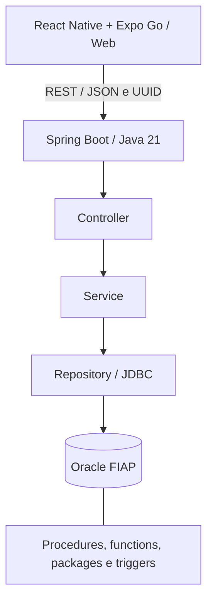

# Lembrei!

Aplicativo CitizenTech para organizar cuidados diários, com foco em pessoas idosas que desejam mais autonomia no acompanhamento de remédios e hábitos. Projeto acadêmico da Global Solution 2 — 2026.

## Problema e proposta

Lembrar os horários dos cuidados, registrar o que já foi realizado e perceber que um remédio está acabando pode ser difícil quando essas informações ficam dispersas. O Lembrei! reúne agenda, confirmações, estoque e progresso semanal em uma interface com textos legíveis, botões amplos e seleção de horário sem digitação no Android.

O público principal são pessoas idosas que utilizam um smartphone. Pessoas com dificuldades de digitação também podem se beneficiar do seletor de horário. O aplicativo não exige login nem senha: identifica cada instalação por um UUID persistido localmente.

A relação com o **ODS 3 — Saúde e Bem-Estar** está no apoio à organização dos cuidados e ao acompanhamento da rotina. O aplicativo não prescreve medicamentos, define doses ou substitui orientação profissional. Os resultados apresentados são registros do usuário e estimativas baseadas na agenda cadastrada.

## Funcionalidades principais

| Funcionalidade | Comportamento |
| --- | --- |
| Cuidados | Cadastrar remédios e hábitos, escolher dias e horários, editar, buscar, arquivar e reativar. |
| Rotina diária | Consultar as ocorrências de uma data, confirmar cuidados e registrar esquecimentos. A confirmação pede uma segunda ação para evitar toques acidentais. |
| Estoque | Consultar saldo, registrar reposições, acompanhar movimentos e identificar previsão de falta em até três dias. A confirmação de remédio desconta o estoque no Oracle. |
| Progresso semanal | Consultar totais e percentual de adesão por semana, considerando ocorrências cujo horário já chegou. |

O nome e a configuração de conexão ficam em Ajustes. Identificação e personalização não são contabilizadas como funcionalidades principais.

## Arquitetura e tecnologias



| Tecnologia | Finalidade e justificativa |
| --- | --- |
| React Native e Expo SDK 57 | Base compartilhada entre celular e navegador; testes com Expo Go sem emulador. |
| TypeScript e Expo Router | Contratos tipados e navegação organizada por arquivos. |
| SecureStore e AsyncStorage | Persistência da identidade no celular e das preferências locais; identidade web no armazenamento do navegador. |
| Seletor nativo de horário | Escolha de horas e minutos sem exigir digitação de `HH:mm` no celular. |
| Java 21 e Spring Boot | API REST dividida em controller, service e repository. |
| Spring JDBC e Oracle JDBC | SQL parametrizado e integração direta com as rotinas PL/SQL. |
| Lombok | Redução de construtores e métodos de acesso repetitivos. |
| Oracle PL/SQL | Automação de geração da rotina, confirmação, estoque e relatórios. |
| Swagger / OpenAPI | Consulta e teste dos contratos HTTP. |

O [SmartHas](https://github.com/GustavoPMarques/SmartHas) foi utilizado como referência de organização. As entidades e regras foram adaptadas ao problema de cuidados diários.

## Organização da documentação

- [README.txt](README.txt): guia de execução e índice em texto simples.
- [Backend](backend-api/lembrei-api/README.txt): endpoints, validações, classes, transações e testes.
- [Aplicativo](mobile-app/README.txt): execução no Expo Go e web, telas, métodos e gerenciamento de memória.
- [Banco](database/README.md): instalação, rotinas PL/SQL e testes.
- [MER, DER e dicionário de dados](database/modelo/README.md).
- [Diagrama relacional em PNG](database/modelo/lembrei_modelo_relacional.png).
- [Segurança e configurações privadas](SEGURANCA.txt).
- [Requisições HTTP de exemplo](backend-api/lembrei-api/docs/requisicoes.http).

## Executar a partir de uma cópia do repositório

Requisitos: JDK 21, Node.js compatível com o SDK 57 (consulte o README mobile), npm, acesso ao Oracle e um cliente como SQL Developer. Para testar no Android, use Expo Go compatível com SDK 57 e a mesma rede local do computador. Não é necessário alterar permanentemente o Java do sistema.

### 1. Preparar o Oracle

Siga o [README do banco](database/README.md). Em um schema novo, execute os scripts `01` a `05` na ordem; `02` é uma carga de exemplo opcional. Execute `06` para verificar as regras. O script `01` é apenas de instalação inicial: não o repita em um schema que já contém as tabelas. A API não instala os objetos automaticamente.

### 2. Iniciar a API

No PowerShell, partindo da raiz do projeto:

```powershell
cd backend-api/lembrei-api
Copy-Item .env.example .env
```

Preencha `ORACLE_URL`, `ORACLE_USER` e `ORACLE_PASSWORD` na `.env`. Copie o modelo somente na primeira configuração, para não sobrescrever um arquivo já preenchido. O Spring importa esse arquivo usando sintaxe Java Properties. Execute com JDK 21 e diretório de trabalho na pasta do `pom.xml`:

```powershell
.\mvnw.cmd spring-boot:run
```

Também é possível executar `LembreiApiApplication` pelo IntelliJ com SDK 21, plugin Lombok e processamento de anotações habilitado. Swagger: `http://localhost:8080/swagger-ui.html`.

### 3. Iniciar o aplicativo

Em outro terminal, partindo da raiz:

```powershell
cd mobile-app
Copy-Item .env.example .env
npm ci
npm start
```

Deixe `EXPO_PUBLIC_API_URL` vazia para detecção automática: host do Expo no celular e `localhost:8080/api/v1` na web local. Para outra API, preencha a URL completa. Um endereço salvo em Ajustes tem prioridade sobre a `.env`.

Abra o QR Code no Expo Go ou pressione `w` para abrir `http://localhost:8081`. API e Expo precisam estar executando; o Oracle precisa estar acessível. No celular, `localhost` representa o próprio aparelho. O túnel do Expo não publica a API automaticamente.

Comandos Linux/macOS equivalentes usam `cp` e `./mvnw`; configure o JDK 21 na sessão. As instruções de rede e as credenciais são próprias de cada computador.

## Memória, eficiência e acessibilidade

O mobile usa `FlatList`, consultas paginadas, cancelamento com `AbortController`, descarte de respostas antigas e limpeza de timers e listeners. Não mantém históricos completos em caches globais nem filas offline crescentes. A API limita paginação e conexões, fecha recursos JDBC e agrega os relatórios no Oracle. As práticas e limites estão detalhados nos READMEs de cada componente.

A interface oferece botões amplos, rótulos acessíveis, status descritos em texto, fontes que acompanham a escala do sistema, tratamento do teclado e seletor nativo de horário. São decisões implementadas; não representam certificação de acessibilidade nem estudo de usabilidade com o público-alvo.

## Verificações e demonstração

No backend: `.\mvnw.cmd clean verify`. Para incluir os testes Oracle, use a `.env` configurada e `$env:LEMBREI_ORACLE_TESTS='true'`. Os testes de integração desfazem seus dados por rollback.

No mobile: `npm run typecheck`, `npm run lint` e `npm test`. Com o Expo executando em `localhost:8081`, `npm run test:e2e` verifica as telas com respostas de API simuladas somente nos testes. Esses testes não substituem a validação do aparelho físico e do Oracle.

Roteiro manual: criar um remédio com estoque e horário já ocorrido hoje; abrir Hoje; confirmar e conferir a baixa; registrar reposição e conferir o histórico; consultar Progresso; criar um hábito para verificar o fluxo sem estoque. Use dados de demonstração e não exponha UUIDs ou credenciais na gravação.

## Limitações e entrega

- A versão atual apresenta a agenda dentro do app; não envia notificações do sistema e não solicita essa permissão.
- Não há funcionamento offline para operações de negócio, autenticação de conta ou recuperação de identidade. Android e web têm UUIDs e dados separados.
- A previsão de estoque presume cumprimento integral da agenda atual e ausência de novas reposições. Não desconta pendências antigas.
- O histórico não reconstrói versões antigas de nome, dose ou agenda. Horários com ocorrências possuem restrições de edição para preservar registros.
- O backend ainda é executado localmente. HTTPS, autenticação adequada para exposição pública e hospedagem precisam ser tratados antes de disponibilização pública do serviço.

A documentação cobre os requisitos técnicos do projeto. Os vídeos e seus links devem ser preparados pela equipe; não há links fictícios de entrega. Após criar o repositório, inclua sua URL em um arquivo `.txt` e compartilhe o acesso com o tutor. Confirme os entregáveis no enunciado e respeite o prazo de 19/11/2026.

Para publicar como um único repositório, a raiz deve incluir `backend-api`, `database` e `mobile-app`. Verifique se há um `.git` dentro de alguma dessas pastas antes de adicioná-las: um repositório interno pode ser registrado como submódulo sem que seu código acompanhe o clone principal. Preserve o histórico necessário e resolva essa organização antes do primeiro envio. Os arquivos `.env` devem permanecer locais; somente `.env.example` acompanha o código.
