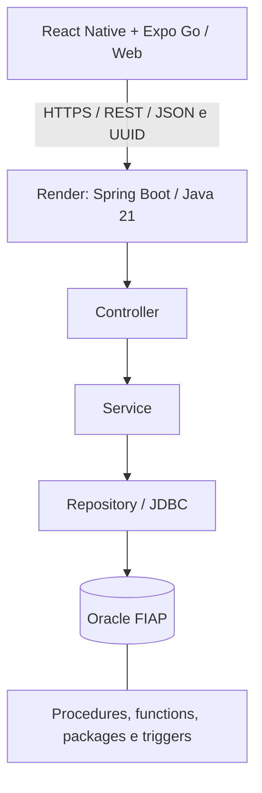

# Lembrei!

Aplicativo CitizenTech para organizar cuidados diários, com foco em pessoas idosas que desejam mais autonomia no acompanhamento de remédios e hábitos. Projeto acadêmico da Global Solution 2 — 2026.

## Problema e proposta

Lembrar os horários dos cuidados, registrar o que já foi realizado e perceber que um remédio está acabando pode ser difícil quando essas informações ficam dispersas. O Lembrei! reúne agenda, confirmações, estoque e progresso semanal em uma interface com textos legíveis, botões amplos e seleção de horário sem digitação no Android.

O público principal são pessoas idosas que utilizam um smartphone. Pessoas com dificuldades de digitação também podem se beneficiar do seletor de horário. O aplicativo não exige login nem senha: identifica cada instalação por um UUID persistido localmente.

A relação com o **ODS 3 — Saúde e Bem-Estar** está no apoio à organização dos cuidados e ao acompanhamento da rotina. Os resultados apresentados são registros do usuário e estimativas baseadas na agenda cadastrada.

## Funcionalidades principais

| Funcionalidade | Comportamento |
| --- | --- |
| Cuidados | Cadastrar remédios e hábitos, escolher dias e horários, editar, buscar, arquivar e reativar. |
| Rotina diária | Consultar as ocorrências de uma data, confirmar cuidados e registrar esquecimentos. A confirmação pede uma segunda ação para evitar toques acidentais. |
| Estoque | Consultar saldo, registrar reposições, acompanhar movimentos e identificar previsão de falta em até três dias. A confirmação de remédio desconta o estoque no Oracle. |
| Progresso semanal | Consultar totais e percentual de adesão por semana, considerando ocorrências cujo horário já chegou. |

O nome e a configuração de conexão ficam em Ajustes. Identificação e personalização não são contabilizadas como funcionalidades principais.

## API publicada

O backend está hospedado no Render com HTTPS e conectado ao Oracle FIAP.
O aplicativo Android e a versão web utilizam a mesma API publicada.

| Acesso | Endereço |
| --- | --- |
| API REST | https://lembrei-api.onrender.com/api/v1 |
| Swagger | https://lembrei-api.onrender.com/swagger-ui.html |
| Contrato OpenAPI | https://lembrei-api.onrender.com/v3/api-docs |

Para testar o aplicativo, instale as dependências de `mobile-app`, copie
`.env.example` para `.env` na primeira configuração e execute `npm start`.
O modelo já contém a URL pública; o backend local pode permanecer desligado.

## Arquitetura e tecnologias



| Tecnologia | Finalidade e justificativa |
| --- | --- |
| React Native e Expo SDK 57 | Base compartilhada entre celular e navegador; testes com Expo Go sem emulador. |
| TypeScript e Expo Router | Contratos tipados e navegação organizada por arquivos. |
| SecureStore e AsyncStorage | Persistência da identidade no celular e das preferências locais; identidade web no armazenamento do navegador. |
| Seletor nativo de horário | Escolha de horas e minutos sem exigir digitação de `HH:mm` no celular. |
| Java 21 e Spring Boot | API REST dividida em controller, service e repository. |
| Spring JDBC e Oracle JDBC | SQL parametrizado e integração direta com as rotinas PL/SQL. |
| Lombok | Redução de construtores e métodos de acesso repetitivos. |
| Oracle PL/SQL | Automação de geração da rotina, confirmação, estoque e relatórios. |
| Swagger / OpenAPI | Consulta e teste dos contratos HTTP. |
| Docker | Compilação em JDK 21 e execução da API em Java 21 no Render. |
| GitHub Actions | Validação do código, testes do Oracle e disparo do deploy do commit aprovado. |

As entidades e regras representam o cadastro de cuidados, a agenda, as confirmações e os movimentos de estoque.

## Organização da documentação

- [README.txt](README.txt): guia de execução e índice em texto simples.
- [Backend](backend-api/lembrei-api/README.md): endpoints, validações, classes, transações e testes.
- [Aplicativo](mobile-app/README.md): execução no Expo Go e web, telas, métodos e gerenciamento de memória.
- [Banco](database/README.md): instalação, rotinas PL/SQL e testes.
- [MER, DER e dicionário de dados](database/modelo/README.md).
- [Diagrama relacional em PNG](database/modelo/lembrei_modelo_relacional.png).
- [Segurança e configurações privadas](SEGURANCA.txt).
- [Requisições HTTP de exemplo](backend-api/lembrei-api/docs/requisicoes.http).

## Executar a partir de uma cópia do repositório

Para testar somente o aplicativo com a API publicada, siga diretamente a etapa 3. As etapas 1 e 2 servem para executar seu próprio backend localmente.

Para usar a API publicada: Node.js compatível com o SDK 57 (consulte o README mobile), npm e Expo Go compatível com SDK 57 no Android. No desenvolvimento com Expo Go, mantenha o aparelho na mesma rede do computador que executa o Expo. Para executar também o backend localmente, use JDK 21, acesso ao Oracle e um cliente como SQL Developer.

### 1. Preparar o Oracle

Siga o [README do banco](database/README.md). Em um schema novo, execute os scripts `01` a `05` na ordem; `02` é uma carga de exemplo opcional. Execute `06` para verificar as regras. O script `01` é apenas de instalação inicial: não o repita em um schema que já contém as tabelas. A API não instala os objetos automaticamente.

### 2. Iniciar a API

No PowerShell, partindo da raiz do projeto:

```powershell
cd backend-api/lembrei-api
Copy-Item .env.example .env
```

Preencha `ORACLE_URL`, `ORACLE_USER` e `ORACLE_PASSWORD` na `.env`. Copie o modelo somente na primeira configuração, para não sobrescrever um arquivo já preenchido. O Spring importa esse arquivo usando sintaxe Java Properties. Execute com JDK 21 e diretório de trabalho na pasta do `pom.xml`:

```powershell
.\mvnw.cmd spring-boot:run
```

Também é possível executar `LembreiApiApplication` pelo IntelliJ com SDK 21, plugin Lombok e processamento de anotações habilitado. Swagger: `http://localhost:8080/swagger-ui.html`.

### 3. Iniciar o aplicativo

Em outro terminal, partindo da raiz:

```powershell
cd mobile-app
Copy-Item .env.example .env
npm ci
npm start
```

O modelo `.env.example` aponta para `https://lembrei-api.onrender.com/api/v1`, usada no Android e na web. Quando essa variável muda, o app atualiza o endereço salvo uma vez, evitando manter um IP local antigo. Depois disso, Ajustes permite personalizar a conexão até a próxima mudança da variável. Para usar uma API local, informe a URL ou deixe a variável vazia para detectar o host do Expo no celular e usar `localhost:8080/api/v1` na web.

Abra o QR Code no Expo Go ou pressione `w` para abrir `http://localhost:8081`. O Expo precisa estar executando para esse teste. Com a URL do Render, a API local pode ficar desligada; o Oracle precisa estar acessível pelo serviço publicado. No celular, `localhost` representa o próprio aparelho. O túnel do Expo não publica uma API local automaticamente.

Comandos Linux/macOS equivalentes usam `cp` e `./mvnw`; configure o JDK 21 na sessão. As instruções de rede e as credenciais são próprias de cada computador.

## Memória, eficiência e acessibilidade

O mobile usa `FlatList`, consultas paginadas, cancelamento com `AbortController`, descarte de respostas antigas e limpeza de timers e listeners. Não mantém históricos completos em caches globais nem filas offline crescentes. A API limita paginação e conexões, fecha recursos JDBC e agrega os relatórios no Oracle. As práticas e limites estão detalhados nos READMEs de cada componente.

A interface oferece botões amplos, rótulos acessíveis, status descritos em texto, fontes que acompanham a escala do sistema, tratamento do teclado e seletor nativo de horário.

## CI/CD com GitHub Actions

O [workflow CI/CD](.github/workflows/ci-cd.yml) executa em push e pull request
para `main`, além de permitir execução manual pelo GitHub Actions.

| Job | Verificação |
| --- | --- |
| `build-test` | Instala Java 21, compila a API, executa os testes e gera o JAR. |
| `mobile-test` | Instala Node 26.6.0 e dependências, verifica TypeScript e lint, executa testes unitários e exporta Android e web. |
| `oracle-db` | Cria Oracle Free descartável, instala os scripts SQL, executa as verificações do banco e os testes Java de integração. |
| `docker-build` | Constrói a imagem da API após backend, mobile e Oracle serem aprovados. |
| `deploy` | Em push na `main` ou execução manual nessa branch, solicita ao Render o deploy do SHA aprovado. |

Os três primeiros jobs executam em paralelo. A imagem Docker depende deles;
o deploy depende de todas as verificações. Pull requests executam a validação.
O fluxo completo foi executado com sucesso no GitHub Actions.

O Auto-Deploy do Render permanece desligado. O job de deploy utiliza Bash e
`curl`, com o Deploy Hook armazenado no secret `RENDER_DEPLOY_HOOK_URL`.
O Render recebe o SHA do commit aprovado e constrói a aplicação pelo Dockerfile.
O resultado da solicitação aparece no Actions; a conclusão da publicação aparece
no painel do Render como **Live**.

Os artefatos `testes-backend`, `testes-oracle` e `lembrei-api-jar` ficam disponíveis
na execução do Actions por sete dias. O Oracle de CI recebe uma senha temporária
e é removido ao final. As credenciais do Oracle FIAP ficam nas variáveis do Render;
os testes do workflow utilizam o banco descartável.

## Verificações e demonstração

No backend: `.\mvnw.cmd clean verify`. Para incluir os testes Oracle, use a `.env` configurada e `$env:LEMBREI_ORACLE_TESTS='true'`. Os testes de integração desfazem seus dados por rollback.

No mobile: `npm run typecheck`, `npm run lint` e `npm test`. Com o Expo executando em `localhost:8081`, `npm run test:e2e` verifica as telas com respostas de API simuladas somente nos testes. A demonstração manual utiliza o aplicativo com a API publicada e o Oracle FIAP.

Roteiro manual: criar um remédio com estoque e horário já ocorrido hoje; abrir Hoje; confirmar e conferir a baixa; registrar reposição e conferir o histórico; consultar Progresso; criar um hábito para verificar o fluxo sem estoque. Use dados de demonstração e não exponha UUIDs ou credenciais na gravação.
