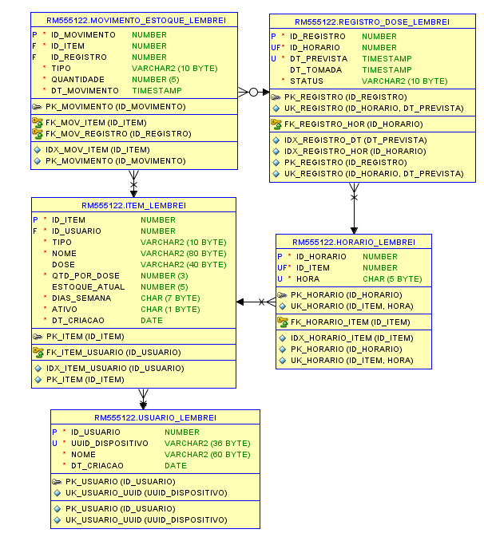

# Banco de dados do Lembrei!

Scripts para Oracle Database 12c ou superior (colunas `IDENTITY`). Use um
schema exclusivo do projeto com permissao para criar tabelas e indices.

Execute no SQL*Plus, SQLcl ou no modo **Executar Script (F5)** do SQL Developer,
na ordem abaixo, a partir desta pasta:

```sql
@lembrei_01_ddl.sql
@lembrei_02_dados_exemplo.sql
@lembrei_03_procedures.sql
@lembrei_04_packages.sql
@lembrei_05_triggers.sql
@lembrei_06_testes.sql
```

Execute cada arquivo inteiro com **F5** e avance somente se nao houver erros.
Se os objetos 01 a 05 ja estiverem instalados, execute apenas o arquivo 06
para repetir os testes.

O primeiro script e exclusivo da instalacao inicial em um schema sem as cinco
tabelas do projeto. Usa CREATE TABLE e CREATE INDEX diretamente, sem helpers
ou validacao automatica de estruturas existentes. Nao apaga nem recria tabelas.
Se as tabelas ja existem, nao execute o arquivo 01 novamente: o Oracle retorna
ORA-00955. Em uma instalacao parcial, confira quais objetos foram criados e
execute somente os comandos faltantes. DDL confirma alteracoes implicitamente.

O segundo e opcional e inclui Maria, dois remedios e um habito, com seus
horarios. O UUID de exemplo e fixo: executar a carga novamente gera erro de
unicidade. A carga e desfeita se alguma insercao falhar.

A carga inclui Maria, Losartana 50 mg (estoque 24, horarios 08:00 e 20:00),
Metformina 850 mg (estoque 3, horario 20:00) e o habito Beber agua (12:00).
Nao inclui registros de doses nem movimentos de estoque. Antes de repetir
o arquivo 02, confira se a carga ja existe:

```sql
SELECT u.nome AS usuario, i.nome AS item, i.tipo, i.estoque_atual, h.hora
FROM usuario_lembrei u
JOIN item_lembrei i ON i.id_usuario = u.id_usuario
JOIN horario_lembrei h ON h.id_item = i.id_item
ORDER BY u.nome, i.nome, h.hora;
```

## Testes integrados

Execute `lembrei_06_testes.sql` com F5 apos instalar os objetos 01, 03, 04 e 05.
A carga 02 nao e necessaria. Use uma sessao dedicada, sem alteracoes pendentes;
o script desliga autocommit e mantem essa configuracao ao terminar.

A suite verifica compilacao e habilitacao das triggers antes de criar dois
usuarios exclusivos. Testa geracao sem duplicatas, confirmacao idempotente,
baixa e reposicao auditadas, estoque insuficiente, habitos, imutabilidade,
confirmacao futura, isolamento por usuario, adesao semanal, previsao por dose,
alertas e validacao do SQL dinamico. Cada verificacao imprime `OK`; valores ou
codigos de erro diferentes dos esperados interrompem a execucao com erro.

O resultado final esperado e `SUCESSO: ... verificacoes aprovadas; dados de
teste desfeitos.` A suite nao executa COMMIT nem cria objetos e desfaz seus
dados com rollback tanto no sucesso como na falha. Os IDs gerados podem
avancar mesmo apos rollback. Nao testa concorrencia entre sessoes.

Na execucao informada em 11/11/2026, os objetos estavam validos, as duas
triggers habilitadas e as 36 verificacoes foram aprovadas no Oracle:

```text
SUCESSO: 36 verificacoes aprovadas; dados de teste desfeitos.
```

A mensagem inicial `nenhuma linha selecionada`, na consulta a `USER_ERRORS`,
indica que nao foram encontrados erros de compilacao. Os dados existentes
sao preservados; somente os dados criados pela suite sao desfeitos.

Os scripts interrompem a execucao ao encontrar um erro. O Oracle confirma DDL
implicitamente; uma falha durante a criacao pode deixar objetos ja criados.

## Convencoes do modelo

- `usuario_lembrei`: nome e UUID gerado no aparelho, sem senha ou login.
- `item_lembrei`: remedio ou habito. `dias_semana` representa segunda a domingo
  (por exemplo, `1111100` para dias uteis). Estoque e obrigatorio para remedios.
- `horario_lembrei`: horarios locais no formato `HH:MM`, sem duplicidade por item.
- `registro_dose_lembrei`: ocorrencias previstas e confirmacoes para o relatorio
  de adesao. Cada horario e instante previsto identifica uma ocorrencia unica.
- `movimento_estoque_lembrei`: historico de baixas e reposicoes com quantidade
  positiva; o tipo indica o sentido do movimento.

Datas e horarios nao possuem fuso embutido. O backend deve usar de forma
consistente o fuso local do usuario ao gerar a rotina e calcular a semana.

As procedures geram ocorrencias, confirmam doses, registram reposicoes e
consultam a adesao semanal. As triggers validam a confirmacao e descontam
o estoque na mesma transacao. O backend deve chamar essas rotinas e o package de calculo para obter
a previsao de termino; nao deve descontar novamente o estoque ao confirmar.
O relatorio depende das ocorrencias registradas, inclusive as nao confirmadas;
a carga de exemplo inclui apenas os cadastros e horarios.

## Procedures, packages e triggers

Os arquivos 03, 04 e 05 usam `CREATE OR REPLACE`, parametros `%TYPE`,
erros de negocio e consultas de verificacao. Podem ser reinstalados sem
apagar dados. Instale os tres antes de confirmar doses. A instalacao requer
permissoes `CREATE PROCEDURE` e `CREATE TRIGGER`.

| Procedure | Parametros, na ordem | Resultado |
| --- | --- | --- |
| `prc_lembrei_gerar_rotina` | usuario, data, quantidade OUT | Gera ocorrencias ausentes para os itens ativos |
| `prc_lembrei_confirmar_dose` | usuario, registro, instante opcional | Confirma uma vez e aciona a baixa |
| `prc_lembrei_repor_estoque` | usuario, item, quantidade | Soma ao saldo e registra reposicao |
| `prc_lembrei_relatorio_semanal` | usuario, data, cursor OUT | Adesao por item na semana ISO da data |

`trg_lembrei_validar_dose` preenche a data de confirmacao quando omitida,
impede confirmacao futura e alteracao de uma confirmacao existente.
`trg_lembrei_baixar_estoque` desconta somente remedios, impede saldo negativo
e grava o movimento. Habitos sao confirmados sem movimento. Repetir a
confirmacao nao gera outra baixa. Uma dose esquecida pode ser confirmada
posteriormente. Sem estoque suficiente a confirmacao e rejeitada.

As procedures nao executam `COMMIT`: o chamador confirma ou desfaz a transacao.
Geracao de rotina e reposicao usam savepoints para desfazer somente a propria
operacao se houver erro. Exclusoes seguem as cascatas do DDL e nao estornam
estoque. Para preservar o relatorio, prefira desativar itens a exclui-los.
Alteracoes diretas no saldo ou no historico de movimentos nao sao auditadas
pelas triggers: reposicoes devem passar pela procedure.

Configure o fuso da sessao Oracle para o usuario antes das chamadas, pois as
rotinas usam `LOCALTIMESTAMP`. Gere a rotina diariamente mesmo quando nao
houver confirmacoes; o relatorio usa somente ocorrencias existentes. Gerar
datas passadas usa os horarios e dias atualmente cadastrados, sem reconstruir
versoes antigas do cadastro. Datas anteriores ao dia de criacao sao ignoradas.
O percentual considera apenas ocorrencias cujo horario ja chegou, incluindo
pendentes e esquecidas no total. Semana sem ocorrencias retorna cursor vazio.

Exemplo no SQL Developer (substitua `1` pelo ID correto):

```sql
VARIABLE qtd NUMBER
EXEC prc_lembrei_gerar_rotina(1, SYSDATE, :qtd);
PRINT qtd
COMMIT;

VARIABLE relatorio REFCURSOR
EXEC prc_lembrei_relatorio_semanal(1, SYSDATE, :relatorio);
PRINT relatorio
```

Os testes de baixa, habitos, reposicao, falta de estoque e rollback estao
centralizados no arquivo `lembrei_06_testes.sql`.

## Packages

O arquivo `lembrei_04_packages.sql` cria specification e body para tres packages,
divididos em calculo, operacao e relatorio:

| Package | Rotinas publicas |
| --- | --- |
| `pkg_lembrei_calculo` | `fun_consumo_semanal`, `fun_previsao_termino`, `fun_precisa_reposicao` |
| `pkg_lembrei_operacao` | `prc_gerar_rotina`, `prc_confirmar_dose`, `prc_repor_estoque` |
| `pkg_lembrei_relatorio` | `prc_relatorio_semanal`, `fun_contar_registros` |

As operacoes e o relatorio semanal delegam as procedures do arquivo 03,
mantendo as mesmas validacoes e transacoes. As triggers continuam responsaveis
pela baixa. O helper `ler_item` do package de calculo e privado.

A previsao retorna o primeiro horario futuro cuja dose nao sera atendida
pelo saldo atual, considerando os dias da semana, horarios e quantidade por
dose. Usa o saldo como disponivel no instante de referencia e presume adesao
integral futura, sem novas reposicoes ou alteracoes no cadastro. Nao desconta
pendencias passadas nem reconstroi o saldo historico. Referencia padrao:
`LOCALTIMESTAMP`. Para habitos, itens inativos ou sem agenda, retorna `NULL`.
O consumo semanal nesses casos e zero e o alerta retorna `N`.

`fun_precisa_reposicao` retorna `S` quando a primeira dose sem saldo estiver
dentro do prazo informado (padrao: constante publica `c_dias_alerta = 3`).
A contagem dinamica aceita somente os cinco nomes exatos das tabelas do
projeto e usa `DBMS_ASSERT`; e uma consulta administrativa global, sem filtro
por usuario, que nao deve ser disponibilizada no app.

Exemplos, substituindo os IDs pelos cadastros corretos:

```sql
VARIABLE qtd NUMBER
EXEC pkg_lembrei_operacao.prc_gerar_rotina(1, SYSDATE, :qtd);
PRINT qtd
COMMIT;

SELECT pkg_lembrei_calculo.fun_consumo_semanal(1, 1) AS consumo_semanal,
       pkg_lembrei_calculo.fun_previsao_termino(1, 1) AS primeira_dose_sem_saldo,
       pkg_lembrei_calculo.fun_precisa_reposicao(1, 1) AS repor
FROM dual;

VARIABLE relatorio REFCURSOR
EXEC pkg_lembrei_relatorio.prc_relatorio_semanal(1, SYSDATE, :relatorio);
PRINT relatorio
```

Ao instalar o arquivo 04, a verificacao deve listar seis objetos `VALID`
(tres `PACKAGE` e tres `PACKAGE BODY`) e nenhum erro em `USER_ERRORS`.
Os calculos sao verificados em `lembrei_06_testes.sql`.
Se as triggers antigas ja foram instaladas pelo arquivo `lembrei_04_triggers.sql`,
execute agora `lembrei_04_packages.sql` e `lembrei_05_triggers.sql`:
os nomes das triggers no banco permanecem os mesmos e `CREATE OR REPLACE`
atualiza os objetos existentes.

## Diagrama relacional

O [MER, DER textual e dicionario de dados](modelo/README.md) descreve as
entidades, cardinalidades, tipos, chaves e regras de integridade do DDL atual.



A imagem PNG exportada do SQL Developer acompanha o repositorio, junto com
o DER em Mermaid. O prefixo nas tabelas identifica o schema de origem.
Atualize os diagramas e o dicionario quando alterar tabelas ou relacionamentos.

Para importar as tabelas existentes no SQL Developer:

1. Acesse **Arquivo > Data Modeler > Importar > Dicionario de Dados**
   (*File > Data Modeler > Import > Data Dictionary*).
2. Selecione a conexao usada para criar as tabelas.
3. Selecione o schema correspondente ao usuario dessa conexao. Para descobrir
   o nome, execute `SELECT USER AS esquema FROM dual;`. O nome da conexao,
   como `FIAP`, pode ser diferente do nome do schema.
4. Selecione somente `USUARIO_LEMBREI`, `ITEM_LEMBREI`, `HORARIO_LEMBREI`,
   `REGISTRO_DOSE_LEMBREI` e `MOVIMENTO_ESTOQUE_LEMBREI` e conclua a importacao.
5. Se o desenho nao abrir, expanda **Modelos Relacionais**, clique com o botao
   direito no modelo e escolha **Mostrar Diagrama (Show Diagram)**.
6. Organize as tabelas para deixar colunas e relacionamentos legiveis.

Para exportar o PNG, selecione a aba do diagrama e acesse
**Arquivo > Data Modeler > Imprimir Diagrama > Para Arquivo de Imagem**
(*File > Data Modeler > Print Diagram > To Image File*). Escolha PNG e salve
como `database/modelo/lembrei_modelo_relacional.png`.

Referencias: [importacao do dicionario de dados](https://www.oracle.com/ocom/groups/public/%40otn/documents/webcontent/269105.html)
e [exportacao do diagrama](https://docs.oracle.com/en/database/oracle/sql-developer-data-modeler/21.2/dmdug/data-modeler-concepts-usage.html).

## Tabelas ja instaladas

Se o aplicativo ja acessa o banco existente, a simplificacao do arquivo 01 nao
exige executar nenhum comando no Oracle. As cinco tabelas, seus nomes, tipos,
restricoes e indices permanecem iguais. Nenhum dado precisa ser apagado.

Para atualizar somente regras PL/SQL, execute os arquivos 03, 04 e 05 com F5,
nessa ordem, e depois 06 para verificar. Nao repita o DDL nem a carga de exemplo.

A organizacao inclui DDL direto, carga separada, procedures,
packages divididos por responsabilidade, triggers e testes. Mantemos bloqueios
FOR UPDATE para proteger o estoque em operacoes simultaneas e validacao do
SQL dinamico. Sao recursos com funcao concreta nas regras do projeto.

## Transacoes, seguranca e automacao

No GitHub Actions, `ci/run_ci.sh` cria um Oracle Free descartavel, com senha
temporaria gerada a cada execucao, e instala 01, 03, 04 e 05. Depois executa
06 e os testes Java de integracao. A carga de exemplo 02 nao e necessaria.
O container e removido no fim. Esse fluxo nao acessa nem altera o Oracle FIAP.

As procedures de escrita nao executam COMMIT: a API controla a transacao com
`@Transactional`. Os savepoints permitem desfazer as alteracoes de uma operacao
que falhou. Os bloqueios `FOR UPDATE` protegem geracao/estoque concorrentes.
O teste SQL usa rollback para seus dados, mas nao valida concorrencia entre sessoes.

A automacao implementada ocorre quando a aplicacao chama as rotinas e quando
as triggers respondem as confirmacoes. Nao existe job DBMS_SCHEDULER instalado.
O enunciado exige rotinas PL/SQL; geracao de rotina, baixa e reposicao auditadas,
previsoes e relatorio cumprem os processos escolhidos para esta solucao.

Nao coloque usuario/senha em comandos CONNECT nos scripts versionados. Use a
conexao local do SQL Developer ou variaveis privadas do ambiente. Os dados do
arquivo 02 sao exemplos; nao representam usuarios reais. O contador dinamico
administrativo nao e disponibilizado pela API.

O modelo de cinco tabelas separa cadastros, horarios, ocorrencias e movimentos,
evitando repetir todos os dados do item a cada confirmacao. Chaves estrangeiras,
unicidade por horario/instante e checks complementam as regras PL/SQL. A baixa
de estoque fica nas triggers para participar da mesma transacao da confirmacao.

Veja tambem o [guia geral](../README.md), a [API](../backend-api/lembrei-api/README.md)
e as [orientacoes de seguranca](../SEGURANCA.txt).
