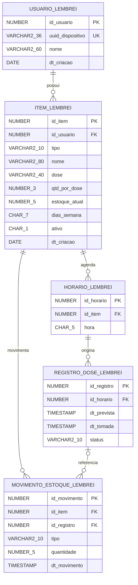

# MER, DER e dicionário de dados

O [DDL](../lembrei_01_ddl.sql) é a definição executável do modelo. O DER em Mermaid abaixo apresenta os tipos e relacionamentos do DDL atual e pode ser visualizado diretamente no GitHub, sem identificar o schema local.

## MER — modelo conceitual

As entidades são **Usuário**, **Item de cuidado**, **Horário**, **Registro de dose** e **Movimento de estoque**. Um item representa remédio ou hábito. Um registro de dose representa uma ocorrência prevista, inclusive para hábitos.

| Relacionamento | Cardinalidade e significado |
| --- | --- |
| Usuário possui Item | Um usuário pode ter zero ou muitos itens. Cada item pertence a exatamente um usuário. |
| Item possui Horário | Um item pode ter vários horários; cada horário pertence a um item. A API exige ao menos um horário no cadastro. |
| Horário origina Registro de dose | Um horário pode originar zero ou muitas ocorrências, cada uma com seu instante previsto. Cada ocorrência pertence a um horário. |
| Item possui Movimento de estoque | Um item pode ter zero ou muitos movimentos. Cada movimento pertence a um item. Hábitos não movimentam estoque pelas rotinas da aplicação. |
| Registro de dose associa Movimento de estoque | Um movimento pode apontar para uma ocorrência ou não, como na reposição. O DDL permite vários movimentos por ocorrência; o fluxo de confirmação impede baixa repetida. |

## DER — modelo lógico relacional

A notação `VARCHAR2_36`, por exemplo, representa `VARCHAR2(36)`; `NUMBER_5` representa `NUMBER(5)`. Foi usada para manter a leitura do Mermaid. PK significa chave primária, FK chave estrangeira e UK chave única.

## Dicionário de dados

Todos os IDs primários usam `NUMBER GENERATED ALWAYS AS IDENTITY`. Campos sem indicação de opcionalidade são obrigatórios.

| Tabela | Campos e significado |
| --- | --- |
| `usuario_lembrei` | `id_usuario`: identificador; `uuid_dispositivo`: UUID único da instalação, `VARCHAR2(36)`; `nome`: nome de exibição, até 60 caracteres; `dt_criacao`: data de cadastro, padrão `SYSDATE`. |
| `item_lembrei` | `id_item`: identificador; `id_usuario`: proprietário; `tipo`: `REMEDIO` ou `HABITO`; `nome`: até 80 caracteres; `dose`: descrição opcional, até 40; `qtd_por_dose`: `NUMBER(3)`, positiva, padrão 1; `estoque_atual`: `NUMBER(5)`, não negativo e obrigatório para remédio; `dias_semana`: sete posições 0/1 de segunda a domingo, padrão `1111111`; `ativo`: `S/N`, padrão `S`; `dt_criacao`: padrão `SYSDATE`. |
| `horario_lembrei` | `id_horario`: identificador; `id_item`: cuidado; `hora`: `CHAR(5)` no formato 24h `HH:mm`. O par `(id_item, hora)` é único. |
| `registro_dose_lembrei` | `id_registro`: identificador; `id_horario`: horário de origem; `dt_prevista`: instante previsto; `dt_tomada`: confirmação opcional; `status`: `PENDENTE`, `TOMADO` ou `ESQUECIDO`, padrão `PENDENTE`. O par `(id_horario, dt_prevista)` é único. `TOMADO` exige `dt_tomada`. |
| `movimento_estoque_lembrei` | `id_movimento`: identificador; `id_item`: remédio; `id_registro`: ocorrência opcional; `tipo`: `BAIXA` ou `REPOSICAO`; `quantidade`: `NUMBER(5)` positiva; `dt_movimento`: padrão `SYSTIMESTAMP`. |

## Integridade e regras complementares

As FKs de usuário para item, item para horário, horário para registro e item para movimento têm `ON DELETE CASCADE`. A FK de movimento para registro tem `ON DELETE SET NULL`. A API não expõe exclusão física; o arquivamento preserva os dados. Remoção de horários com registros é bloqueada na camada de serviço.

Índices explícitos: `idx_item_usuario`, `idx_horario_item`, `idx_registro_hor`, `idx_registro_dt` e `idx_mov_item`. As restrições PK e UNIQUE também dão suporte à identificação e prevenção de duplicatas.

O DDL valida tipos, referências e domínios. A API acrescenta limites como 1–24 horários e pelo menos um dia selecionado. As rotinas PL/SQL e triggers validam a confirmação, impedem estoque insuficiente e registram o movimento na mesma transação. O modelo não contém senha ou entidade de login.

Datas Oracle são armazenadas sem offset. A API configura a sessão em `America/Sao_Paulo`; o mobile interpreta os instantes locais no mesmo fuso. A criação de uma ocorrência não envia uma notificação do sistema.

A [imagem PNG exportada do SQL Developer](lembrei_modelo_relacional.png) acompanha o repositório e complementa o DER em Mermaid. O prefixo nas tabelas identifica o schema de origem. Após alterações de estrutura, atualize os diagramas e o dicionário conforme o DDL. Para exportar a imagem, siga o [guia do banco](../README.md).
